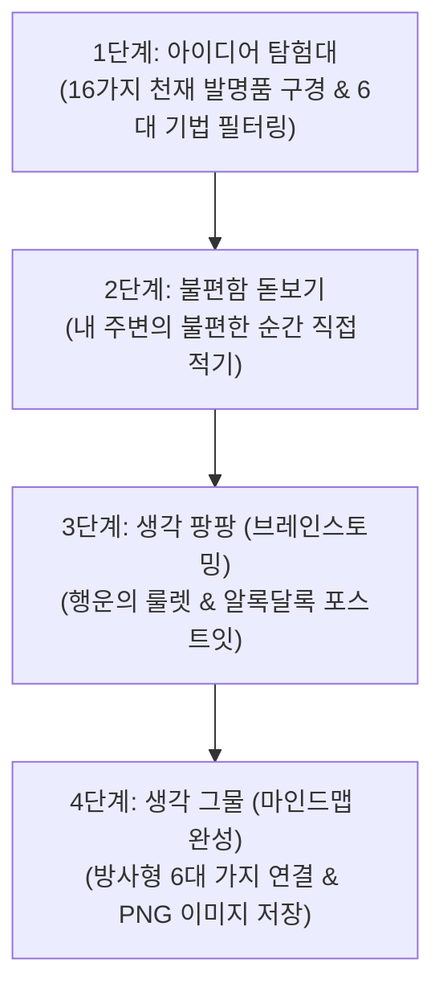

# [PRD] 초등 6학년을 위한 신나는 발명 공작소 (Invention Lab)

> **프로젝트명**: `번뜩이는 발명 공작소 (Spark Invention Lab)`  
> **대상 사용자**: 초등학교 6학년 학생 및 실과/창체 수업 교사  
> **적용 교육과정**: 초등학교 6학년 실과 [생활 속의 발명과 문제 해결] 단원 연계  
> **핵심 발명 기법**: **더하기, 빼기, 모양바꾸기, 반대로하기, 용도바꾸기, 크기바꾸기 (6대 기법)**  
> **활동 구성**: **4단계 완결형 활동 (탐험대 ➔ 불편 찾기 ➔ 생각 팡팡 ➔ 생각 그물)**  
> **기반 자료**: `작지만_세상을_바꾸는_천재적인_아이디어들_요약.pdf` (16가지 실생활 발명 사례)

---

## 1. 프로젝트 개요 (Overview)

### 1.1 배경 및 목적
- 초등학교 6학년 학생들이 일상 속 불편함을 주도적으로 발견하고, 교과서에 나오는 **6가지 대표 발명 기법**을 적용하여 아이디어를 발산하고 **생각 그물(마인드맵)**로 구조화할 수 있는 **웹 기반 인터랙티브 수업 교구**입니다.
- 유튜브 캡처본에서 불필요한 자막과 UI를 모두 잘라내어 **'그 물건이 나오는 사진'**만 100% 깔끔하게 제공합니다.
- 복잡한 카드 작성이나 스케치 단계를 배제하고, **아이디어 발산(브레인스토밍)과 구조화(생각 그물 마인드맵)**에 집중하여 1~2차시(40~80분) 동안 학생 전원이 높은 집중력으로 완성도 높은 생각 그물 산출물을 얻도록 합니다.

### 1.2 핵심 목표 (Goals)
1. **6대 발명 기법 집중**: 더하기, 빼기, 모양바꾸기, 반대로하기, 용도바꾸기, 크기바꾸기
   - 특히 **'용도바꾸기'**: *"물건의 원래 용도를 다른 용도로 바꾸어 만듭니다."*
2. **시각적 몰입감**: 16가지 크롭 발명품 사진, 행운의 발명 룰렛 🎲, 알록달록 가상 포스트잇, 자유로운 드래그 마인드맵 캔버스.
3. **직관적인 4단계 수업 플로우**:
   - [1단계: 아이디어 탐험대] ➔ [2단계: 불편함 돋보기] ➔ [3단계: 생각 팡팡! 브레인스토밍] ➔ [4단계: 생각 그물 (마인드맵) 완성]
4. **무설치 간편 실행**: 교내 PC, 크롬북, 태블릿 어디서나 브라우저 더블클릭으로 즉시 구동.

---

## 2. 6가지 핵심 발명 기법 정의 (초등 6학년 맞춤)

| 기법 명칭 | 쉬운 설명 (어린이 눈높이) | 생활 속 대표 예시 | PDF 속 16개 아이디어 매핑 예시 |
| :--- | :--- | :--- | :--- |
| ➕ **더하기** | 기존 물건에 다른 물건이나 기능을 하나 더 합쳐요! | 연필 + 지우개 = 지우개 달린 연필 | 쇼핑카트 + 계산기 거울 + 따뜻한 열선(김서림 방지) 신호등 + 남은 시간 카운트다운 |
| ➖ **빼기** | 거추장스럽고 불편한 부품이나 과정을 쏙 빼버려요! | 줄을 뺀 무선 줄넘기, 씨 없는 수박 | 형광펜 촉 가운데를 비워 글자 보이게 하기 직원 응대를 뺀 셀프 장바구니 |
| 🔄 **모양바꾸기** | 모양이나 구조를 살짝 꺾거나 파내서 편리하게 바꿔요! | 주름이 있어 굽어지는 빨대 | 가방 끈이 걸리도록 홈을 판 의자 바닥에 닿지 않게 받침 돌기를 단 뒤집개 벌집 모양으로 펑크 안 나는 자전거 바퀴 |
| 🔀 **반대로하기** | 순서, 위치, 위아래, 안팎을 거꾸로 뒤집어 생각해요! | 거꾸로 세워 바로 나오는 케첩통 | 등받이를 뒤집어 테이블로 변신하는 벤치 휴지 겉면뿐 아니라 휴지심 속 빈 공간을 활용 |
| ♻️ **용도바꾸기** | 물건의 원래 용도를 다른 용도로 바꾸어 만들어요! | 장화를 꽃 화분으로 쓰기, 폐타이어를 놀이터 그네로 쓰기 | 사람이 마시는 음수대 ➔ 남은 물을 반려견 음수대로 쓰기 손 씻은 물 ➔ 버리지 않고 변기 세척수로 바꾸어 쓰기 |
| 🔍 **크기바꾸기** | 아주 작게 줄여서 들고 다니거나, 아주 크게 늘려봐요! | 접어서 가방에 쏙 들어가는 3단 우산 | 두루마리 휴지심 속에 들어가는 **미니 휴대용 휴지** |

---

## 3. 4단계 수업 활동 흐름 (Learning Journey)

### 1단계 : 💡 아이디어 탐험대 (Explore)
- 16가지 실제 천재 발명품 카드(불필요한 유튜브 UI가 제거된 깨끗한 물건 사진)를 구경합니다.
- 6대 기법 필터 버튼(`[전체]`, `[➕ 더하기]`, `[➖ 빼기]`...)으로 모아볼 수 있습니다.
- 카드 클릭 시 확대 모달로 Before(불편함), After(해결책), 천재적인 이유를 상세히 살펴보고 **"이 기법으로 나도 아이디어 내볼래!"** 버튼으로 바로 다음 단계로 넘어갑니다.

### 2단계 : 🔍 불편함 돋보기 (Problem Discovery)
- 학생이 실생활에서 직접 겪은 귀찮거나 불편한 상황을 스스로 찾아 집중해서 작성합니다.
- **장소 칩 선택**: [🏫 학교/교실], [🏠 우리 집/방], [🍽️ 식사/주방], [🚽 화장실], [🚌 등하굣길/버스], [🌧️ 비오는 날], [🎒 가방/소지품]
- **어린이용 3문장 문장 완성기**:
  1. **언제/어디서?**: (예: 비 오는 날 아침 교실에 들어올 때)
  2. **무엇이 불편했나요?**: (예: 우산에서 빗물이 뚝뚝 떨어져 복도가 미끄럽고 옷이 젖어요)
  3. **어떻게 해결하고 싶나요?**: (예: 비닐을 안 쓰고도 빗물을 싹 닦아주는 물건이 있으면 좋겠어요)
- [이 불편함 해결하러 가기 ➔] 버튼을 누르면 이 문제가 3단계와 4단계 생각 그물의 중심 주제로 설정됩니다.

### 3단계 : 💥 생각 팡팡! 브레인스토밍 (Brainstorming Board)
- **행운의 발명 룰렛 🎲**:
  - 버튼을 누르면 룰렛이 회전하고, 6가지 기법 중 하나가 뽑히며 어린이 눈높이 힌트 질문 제시
- **알록달록 포스트잇 보드**:
  - 노랑, 분홍, 하늘, 연두색 포스트잇에 떠오르는 생각을 자유롭게 적고 붙입니다.
  - 마우스나 손가락으로 드래그하여 배치하고, ❤️(좋아요) 투표 가능
  - `[그물로 연결 ➔]` 버튼을 누르면 해당 아이디어가 즉시 4단계 생각 그물에 나뭇가지로 도킹됩니다.

### 4단계 : 🕸️ 생각 그물 (마인드맵 최종 완성 & 저장)
- **부드러운 곡선(Bezier) SVG 마인드맵**:
  - **중심 줄기**: 2단계에서 정의한 핵심 불편함
  - **1차 가지**: 6가지 발명 기법 (`더하기`, `빼기`, `모양바꾸기`, `반대로하기`, `용도바꾸기`, `크기바꾸기`)
  - **2차 잎사귀**: 3단계 포스트잇에서 보낸 아이디어 및 `[+]` 버튼으로 추가한 세부 아이디어
- **인터랙션 및 최종 저장**:
  - 자유로운 드래그 이동, 줌(확대/축소), 화면 이동, 더블클릭 글자 수정
  - `[🖼️ 생각 그물 이미지(PNG) 저장]`: 완성된 생각 그물 도화지를 고해상도 이미지 파일로 바로 다운로드
  - `[💾 백업 / 📂 불러오기]`: JSON 파일 저장 지원
  - 컴퓨터 `localStorage` 자동 세이브로 새로고침 안심 방지

---

## 4. 기술 사양 (Technical Specs)
- **무설치 순수 웹 (Vanilla HTML5 / CSS3 / ES6 JS)**
- **16개 정밀 크롭 사진 에셋**: `assets/images/captures/*.png`
- **반응형 디자인 & 터치 호환**: PC 마우스 및 태블릿 터치 완벽 지원
